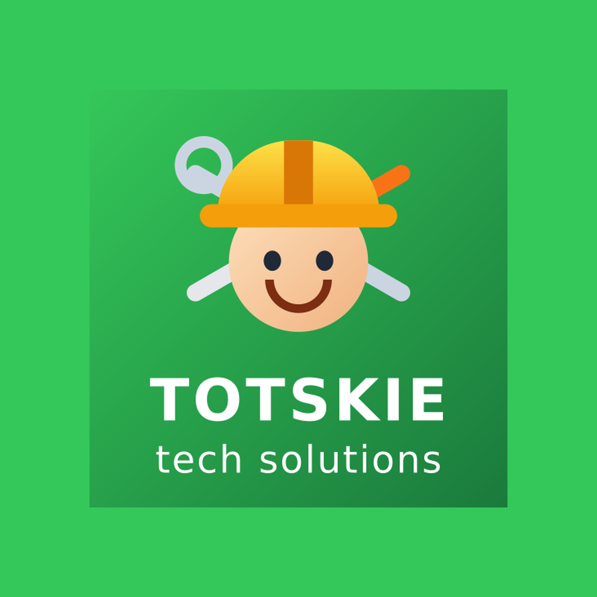

# Spoken Reminder App

A Flask reminder app that speaks reminders out loud (Filipino or English) and gets more insistent until you mark it done.

## Features
- Add, edit, delete, pause/resume, done
- Repeat every N seconds, daily, weekly, monthly
- Escalating spoken lines, faster and higher each repeat
- Per-reminder language (Filipino / English)
- Alarm tones: beep, double beep, siren, chime, or your own song
- Snooze 5 / 15 / 30 minutes

## Requirements
Android phone with Termux and Termux:API, plus Python and Flask.

## Setup
    pkg install python termux-api
    pip install flask
    python app.py

Open http://localhost:5050 and keep Termux open.

## Notes
- Reminders are saved in reminders.json.
- Edit lines.txt / lines_en.txt to change the angry lines.
- Prototype. A standalone Android APK is planned.

## Screenshots

